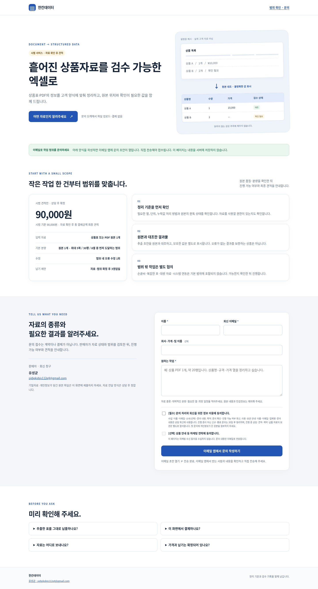

# 한칸데이터 — 상품표를 다시 쓰기 쉬운 엑셀로

**상품을 옮겨 적고 다시 확인하는 작업을 맡기세요.**
공급사 PDF·상품목록에서 필요한 열을 정리해 상품 등록이나 거래처 견적 전 검토에 쓸 수 있는 표를 만듭니다.

### 어떤 결과를 받나요?
- 필요한 열로 정리한 엑셀 파일
- 항목을 다시 찾을 수 있는 원본 위치
- 읽기 어렵거나 확인이 필요한 값의 목록

상품코드의 앞자리 0, 규격 기호, 포장 단위는 합의한 기준으로 보존합니다. 불명확한 값은 추측하지 않습니다.

### 결과물부터 확인하세요
[검수용 엑셀 샘플](portfolio/sample-review.xlsx) · [원본 모의 자료](portfolio/sample-input.csv) · [검수 기준](portfolio/검수기준.md)

샘플은 합성 자료입니다. 실제 고객 실적이나 정확도 보장으로 제시하지 않습니다.

**문의는 아래 네 가지만 알려주세요. 원본 첨부는 아직 필요 없습니다.**

> ① 자료 종류(PDF/엑셀 등) ② 대략적인 쪽수·행수 ③ 필요한 열 ④ 희망 일정

[유성균에게 작업 개요 문의하기](mailto:sjdjeksbjs112e4@gmail.com?subject=%ED%95%9C%EC%B9%B8%EB%8D%B0%EC%9D%B4%ED%84%B0%20%EC%9E%91%EC%97%85%20%EB%AC%B8%EC%9D%98)

---

상품표·PDF의 정보를 필요한 열의 엑셀로 정리하고, 원본 위치와 확인이 필요한 값을 함께 남기는 소량 작업입니다.

**운영: 유성균 · 문의: [sjdjeksbjs112e4@gmail.com](mailto:sjdjeksbjs112e4@gmail.com)**

## 작업을 문의하려면

이메일에 **자료 종류, 대략적인 행수·쪽수, 필요한 열, 희망 일정**을 적어 보내주세요. 처음에는 개인정보·계좌정보·기밀이 담긴 원본을 첨부하지 마세요. 처리 방식과 자료 사용권, 보관·삭제를 합의한 뒤 필요한 샘플을 받습니다.

| 항목 | 시범 작업 기준 |
|---|---|
| 범위 | 원본1개, 최대5쪽·30행·8열 중 먼저 도달하는 분량 |
| 납품 | 엑셀 파일과 검수·확인 필요 목록 |
| 기준가 | 90,000원. 자료 상태·범위 검토 후 총 결제금액 최종 견적 |
| 일정 | 자료·범위 확정 후3영업일 기준 |
| 수정 | 합의한 범위의 오류수정1회 |

스캔·손글씨·복잡한 표·대량자료·시스템연동은 가능 여부와 견적을 따로 확인합니다. 불명확한 가격·규격은 추측해서 채우지 않습니다. 정확도100%나 매출증가를 보장하는 상품이 아닙니다. 견적에 합의하기 전에는 계약·결제가 확정되지 않습니다.

## 모의 자료로 확인하는 결과물

아래 자료는 **합성 모의자료**이며 실고객의 자료·실적·AI 처리 성능을 보여주는 것은 아닙니다.

- [문자열을 보존한 검수용 엑셀 예시](portfolio/sample-review.xlsx)
- [원본 모의 상품표 CSV](portfolio/sample-input.csv)
- [예시의 검수 기준](portfolio/검수기준.md)
- [소개 페이지 HTML 파일](sales.html) — 내려받아 열 수 있습니다. 이메일 작성창만 열며, 실제 전송은 이메일 앱에서 직접 해야 합니다.

## 확인할 사항

이 저장소는 서비스 소개와 포트폴리오 자료를 게시하는 곳입니다. 자동결제·파일접수·주문확정 기능은 제공하지 않습니다. 문의 후 실제 자료와 필요한 결과를 확인해 진행 여부를 안내합니다. 원본 자료를 저장소 이슈·댓글에 공개하지 마세요.
